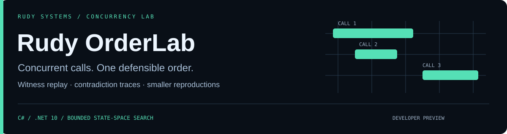
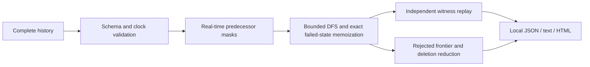

<p align="center"></p>

<p align="center">
<a href="https://github.com/r4venrudy/rudy-orderlab/actions/workflows/ci.yml"></a>

<a href="LICENSE"></a>
<a href="https://rudy.systems"></a>
</p>

**Two compare/exchanges both claim they changed the same initial value. A queue returns its second item first. A cache returns yesterday's value after today's write completed. Can those observations belong to a legal execution?**

Rudy OrderLab searches complete concurrent operation histories against executable sequential specifications. It preserves real-time constraints while exploring overlapping calls, independently replays successful witnesses, explains an explored rejection frontier, and reduces failed histories into recheckable examples.

Developer preview · native C# core · seven models · exact-state memoization · bounded search · local HTML timelines · real multithreaded recording examples · no cloud service or telemetry.

## Investigate a history

Download and verify a [release package](https://github.com/r4venrudy/rudy-orderlab/releases). Native packages are self-contained: use `bin/orderlab` or `bin\orderlab.exe`.

```sh
bin/orderlab check examples/synthetic/overlap-register.json --format html --output overlap.html
bin/orderlab check examples/synthetic/stale-register.json --format json
bin/orderlab verify examples/synthetic/overlap-register.json --witness 2,1
bin/orderlab shrink examples/synthetic/shrink-me.json --output reduced-history.json
bin/orderlab record-demo new-counter-history.json
```

The first history has a valid read-before-write witness because the operations overlap. The second returns `1`: the write completed before the stale read began, so the model cannot explain it. `shrink` also returns `1` when it successfully saves a still-rejected history. The real counter demo performs 32 `Interlocked.Increment` calls across four workers; it records actual invocation/response positions.

| Result | Meaning | Exit |
| --- | --- | --- |
| `Linearizable` | This complete history has a legal sequential explanation, preserving every real-time edge | `0` |
| `NotLinearizable` | Exhaustive search rejected this history under the selected specification | `1` |
| `Inconclusive` | A search budget or cancellation stopped the check | `2` |
| Input / usage / I/O error | The history cannot be checked under this contract | `2` |

Passing one history does not prove an implementation correct. Rejection depends on the adapter, initial state, model and clock contract; it does not identify a unique code defect. No claim of industry certification, novel algorithmic superiority or production readiness is made.

## Seven executable specifications

| Model | Supported operations |
| --- | --- |
| Register | `write(value) → null`, `read() → value` |
| CAS register | Register operations plus `cas(expected,new) → "true"/"false"` |
| Atomic counter | `add(delta) → new integer`, `read() → integer`; signed 64-bit checked arithmetic |
| Set | `add`, `remove`, `contains` with boolean results, plus `size` |
| FIFO queue | `enqueue`, `dequeue`, `peek`; null denotes an empty observation |
| LIFO stack | `push`, `pop`, `peek`; initial values run bottom to top |
| Key-value map | `put`, `get`, `delete`, `size`; whole-map atomic state |

All values are bounded strings; integer/boolean results use canonical strings. Histories contain complete calls only, unique IDs, sequential client IDs and distinct globally comparable logical invocation/response ticks. Do not combine unsynchronized machine timestamps. [Full schema and model contracts](docs/SCHEMA.md) · [Record your implementation](docs/INTEGRATION.md).

## How the search earns its conclusion



Each search node contains completed-operation membership and exact sequential object state. Only real-time-enabled operations whose recorded result matches a specification transition can advance. `--partition` checks independent objects separately and independently replays the merged witness. It never partitions arbitrary map keys or transactions. Rejection explanations describe one explored frontier; search explores all alternatives before issuing a negative verdict.

The design follows the established history-checking approach described by [Wing and Gong](https://www.cs.cmu.edu/~wing/publications/WingGong93.pdf) and the [Herlihy–Wing linearizability definition](https://www.cs.cmu.edu/~wing/publications/HerlihyWing90.pdf). [Design and limits](docs/DESIGN.md).

## Build, test and integrate

Use the .NET 10 SDK. Core, command, examples, tests and benchmarks use only platform libraries; `NuGet.Config` clears external feeds for source builds. Python 3.9+ standard library supports independent CLI tests and packaging.

```sh
dotnet run --project tests/OrderLab.Tests -c Release
dotnet build src/OrderLab.Cli -c Release
python tests/integration.py src/OrderLab.Cli/bin/Release/net10.0/orderlab .
dotnet run --project benchmarks/OrderLab.Benchmarks -c Release
```

On Windows use `orderlab.exe` and set `DOTNET_ROOT` if using a portable SDK. The native test suite differentially checks **1,120 generated histories** against an independent permutation oracle across all seven models, compares partitioned verdicts, mutates/truncates inputs and checks real `Interlocked` recordings. Independent Python tests check fixture verdicts, digests, replay, budgets, privacy and file preservation. [Validation scope](docs/VALIDATION.md) · [Benchmark methodology](benchmarks/README.md).

Reference `src/OrderLab.Core/OrderLab.Core.csproj` for `HistoryRecorder`, `Checker`, `PartitionChecker`, `WitnessVerifier` and `Shrinker`. The [ConcurrentQueue sample](examples/OrderLab.Sample) is runnable. Trusted compiled callers can implement `IModel`; histories cannot load plugins or execute code.

## Resource and disclosure contract

- Input: at most 8 MiB, 256 completed operations, 256 initial strings, 1,024 UTF-16 units per string, no control characters or malformed Unicode. At most four arguments per operation.
- Search: default 100,000 visited states and 10 seconds; `--max-states` allows 1..1,000,000 and `--timeout-ms` 1..60,000. Exact failed-state text caching stops at 32 MiB, excluding collection overhead. Worst-case time is exponential.
- Shrink: default 128 checks, per-check 10,000 states / 500 ms, total wall-time stop around 10 seconds plus a final in-progress check. One-deletion-minimal means no single operation can be removed while retaining rejection; it does not mean globally smallest.
- Reports: 16 MiB maximum; exclusive creation preserves existing files and aliases. POSIX files request `0600`; Windows inherits destination permissions. I/O failure can leave a partial newly created file.
- Raw IDs, clients, object names and value strings stay out of reports by default. Values receive SHA-256 identities; `--include-values` explicitly includes plaintext in JSON/HTML evidence. Digests, timing and operation shape can still identify data. Reports are not anonymization.
- Reduced histories and recorded demo files contain actual history values. Preserve them like source evidence. Stable opened-file content is rechecked after analysis; this is not an atomic snapshot guarantee against hostile writers or changed-and-restored data.

No TCP/TLS captures, network probing, service access, database credentials, liveness checking, eventual-consistency inference, pending/indeterminate operations, cross-object transactions or distributed clock repair are implemented in this preview.

[Security](SECURITY.md) · [Contributing](CONTRIBUTING.md) · [Release validation](docs/RELEASE.md) · [Rudy Systems](https://rudy.systems)
